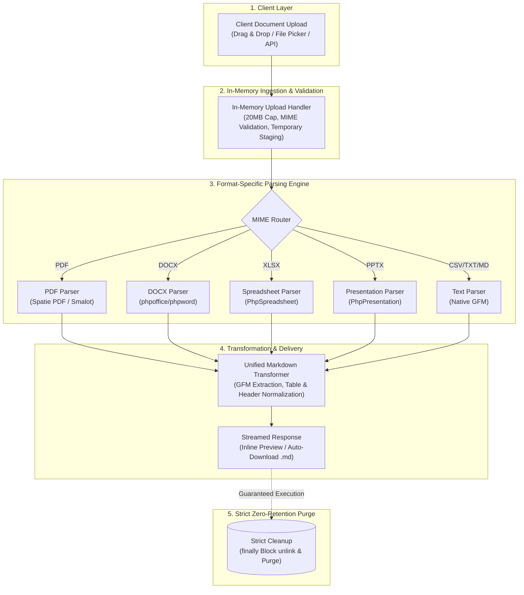

<div align="center">

# filemd

### Zero-Retention, In-Memory Document to Markdown Converter

A fast, zero-friction web tool and API that converts multi-format documents (PDF, DOCX, XLSX, PPTX, TXT, CSV) into clean GitHub Flavored Markdown. Zero login, zero database, and strict zero file retention.

[](#tech-stack)
[](#tech-stack)
[](#tech-stack)
[](#supported-formats--markdown-output)
[](#zero-retention-architecture)
[](LICENSE)

[Quick start](#quick-start) · [Architecture](#zero-retention-architecture) · [Features](#key-features) · [Supported formats](#supported-formats--markdown-output) · [API reference](#api-contract) · [Troubleshooting](#troubleshooting)

</div>

---

> Built for AI workflows and privacy-first note-taking: drop complex enterprise documents and get clean, LLM-ready Markdown instantly — no accounts, no tracking, and files are permanently purged from the server immediately after conversion.

---

## Zero-Retention Architecture



---

## Key Features

<table>
  <tr>
    <td width="50%" valign="top">
      <h4>Format Parsing & Conversion Engine</h4>
      <ul>
        <li><strong>7 Formats Supported</strong>: Full conversion support for PDF, DOCX, XLSX, PPTX, TXT, MD, and CSV documents.</li>
        <li><strong>High-Fidelity GFM Extraction</strong>: Extracts hierarchical headings (<code>#</code>, <code>##</code>), bold/italics typography, and tabular structures.</li>
        <li><strong>Sheet & Slide Segmentation</strong>: Multi-sheet Excel files segment into <code>## Sheet Name</code>; PowerPoint decks partition into <code>## Slide N: Title</code>.</li>
        <li><strong>Single & Batch Processing</strong>: Single files display inline with raw/preview toggles; batch uploads merge into a unified downloadable <code>.md</code>.</li>
        <li><strong>Isolated Error Boundary</strong>: Malformed or password-protected files fail independently without interrupting remaining batch items.</li>
      </ul>
    </td>
    <td width="50%" valign="top">
      <h4>Privacy, Security & User Experience</h4>
      <ul>
        <li><strong>Strict Zero File Retention</strong>: Temporary files are deleted in an unescapable <code>finally</code> block; zero database, zero content logs.</li>
        <li><strong>Zero-Friction Interface</strong>: Seamless drag & drop upload surface with instant one-click clipboard copy functionality.</li>
        <li><strong>Dual-View Mode</strong>: Side-by-side editing workspace with split raw Markdown code and live rendered HTML preview.</li>
        <li><strong>REST API Endpoint</strong>: Programmatic <code>POST /api/convert</code> endpoint ready for CI/CD runners and AI agent workflows.</li>
        <li><strong>Lightweight Architecture</strong>: Zero persistent state, zero user tracking cookies, and minimal memory footprint.</li>
      </ul>
    </td>
  </tr>
</table>

---

## Supported Formats & Markdown Output

| Format | Extension | Parsing Strategy | Markdown Output Format |
|---|---|---|---|
| **PDF** | `.pdf` | Multi-page text parser (Spatie / Smalot PDF) | Page text separated by `---`; leading title identified as `# Title`. |
| **Word** | `.docx` | XML document parser (`phpoffice/phpword`) | Preserves `#` / `##` hierarchy, bold/italics, GFM tables, and tags images as `[image omitted]`. |
| **Excel** | `.xlsx` | Workbook sheet iterator (`phpoffice/phpspreadsheet`) | Segmented per sheet into `## Sheet Name` followed by structured GFM tables. |
| **PowerPoint** | `.pptx` | Presentation slide extractor (`phpoffice/phppresentation`) | Slides demarcated as `## Slide N: Title`, bullets as nested lists, speaker notes as blockquotes. |
| **CSV** | `.csv` | Streaming delimiter parser | Auto-detects delimiters; converts row 1 into table headers with aligned GFM columns. |
| **Plain Text** | `.txt`, `.md` | Raw UTF-8 stream reader | Passed through cleanly with standard UTF-8 character normalization. |

---

## Tech Stack

| Layer | Technology | Purpose |
|---|---|---|
| **Backend API** | Laravel 11 / PHP 8.2+ | Headless REST API routing, request validation, and upload streaming |
| **Document Parsers** | Spatie pdf-to-text / Smalot, PhpWord, PhpSpreadsheet, PhpPresentation | Dedicated parsers for deep document structure inspection and text extraction |
| **Frontend UI** | React 19 / TypeScript / Vite / Tailwind CSS v4 | Zero-latency reactive client with drag & drop interface and split preview |
| **Markdown Engine** | Unified GFM Transformer | AST normalization for headings, tables, code fences, and list items |
| **Security & Privacy** | Ephemeral File Unlink (`sys_get_temp_dir`) | Guaranteed immediate file destruction inside execution `finally` blocks |
| **Hosting & Ops** | Nginx / Linux (EC2, VPS, Containers) | Lightweight reverse proxy with 25MB body size limits and HTTPS termination |

---

## Quick Start

### Prerequisites

- **PHP**: 8.2 or higher (`php-cli`, `php-fpm`, `php-xml`, `php-mbstring`, `php-zip`, `php-gd`)
- **Composer**: 2.x
- **Node.js**: 20+ and **npm**

### Backend Setup

```bash
cd backend
composer install
cp .env.example .env
php artisan key:generate
php artisan serve
```

The API server will boot at `http://localhost:8000`.

### Frontend Setup

```bash
cd frontend
npm install
npm run dev
```

The web client will launch at `http://localhost:5173`.

---

## API Contract

`filemd` provides a headless REST API for automated ingestion and agentic pipelines.

### Convert Documents

`POST /api/convert`

**Request Headers:**
```http
Accept: application/json
Content-Type: multipart/form-data
```

**Parameters:**
- `files[]` (*required*, multipart array): One or more files to convert (maximum 20 MB each).

#### Single File Response (`200 OK`)

```json
{
  "type": "single",
  "filename": "quarterly-report.pdf",
  "markdown": "# Quarterly Report\n\nExecutive summary of platform metrics...",
  "pages": 4
}
```

#### Batch Files Response (`200 OK`)

```json
{
  "type": "multiple",
  "files": [
    {
      "filename": "specs.docx",
      "markdown": "# Architecture Specifications\n\nCore pipeline details..."
    },
    {
      "filename": "metrics.xlsx",
      "markdown": "## Sheet1\n\n| Q1 Revenue | Q2 Revenue |\n|---|---|\n| $1.2M | $1.4M |"
    }
  ]
}
```

#### Error Response (`422 Unprocessable Content`)

```json
{
  "error": true,
  "message": "File type not supported.",
  "filename": "archive.zip"
}
```

### Health Check

`GET /api/health`

```json
{
  "status": "ok"
}
```

---

## Troubleshooting

| Symptom / Edge Case | Root Cause | Resolution Strategy |
|---|---|---|
| **Encrypted / Password-Protected PDF** | Document metadata has strict password encryption | Remove password encryption prior to upload; protected files return `422 Unprocessable Content`. |
| **Scanned / Pure-Image PDF** | Document contains bitmap scans without digital text | Pre-process with an OCR utility (Tesseract / Adobe) before uploading; parser extracts digital text only. |
| **Upload Rejected (413 or 422)** | Document exceeds the 20 MB file size limit | Compress document or split large workbooks into individual files; validated client and server-side. |
| **Malformed Excel or CSV Table** | Non-standard delimiters or irregular merged cells | Standardize CSV delimiters to commas/semicolons and unmerge complex workbook header cells. |
| **CORS Policy Error** | Client origin does not match backend `FRONTEND_URL` | Set `FRONTEND_URL=http://localhost:5173` in `backend/.env` and reload `php artisan serve`. |

---

## Modular Documentation Index

Comprehensive technical specifications and implementation guides are organized into modular documents:

| Document | Description | Target Audience |
|---|---|---|
| [docs/PRD.md](docs/PRD.md) | Product Requirements — problem scope, user stories, and conversion criteria | Product Managers & Contributors |
| [docs/SRS.md](docs/SRS.md) | Software Requirements — architectural specifications, API schemas, security | Core Engineers & Architects |
| [docs/STRUCTURE.md](docs/STRUCTURE.md) | Complete directory taxonomy and detailed module responsibilities | Developers & Maintainers |
| [docs/TODO.md](docs/TODO.md) | Planned feature roadmap, backlog, and known architectural gaps | Contributors & Reviewers |
| [SESSION-PROMPTS.md](SESSION-PROMPTS.md) | Copy-paste workflow prompts for PM, DEV, and QA agent sessions | Autonomous Agents & Operators |

---

## License

This project is licensed under the terms of the [MIT License](LICENSE).

<div align="center">
  <sub>Zero login. Zero database. Zero file retention.</sub><br/>
  <a href="#filemd">Back to top ↑</a>
</div>
